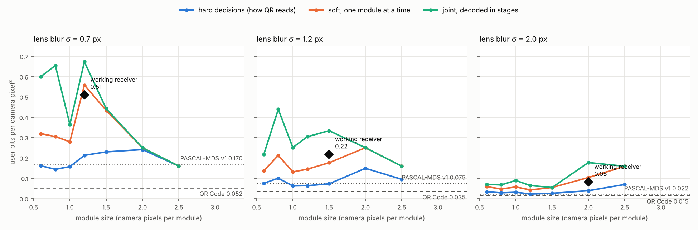

# Research: how far beyond QR can a 2D code go?

Goal of the project: a 2D code that carries far more data per printed area
than QR Code, spending the computing power of current phones on decoding.

The [2026-10-19 density study](density/README.md) adds a different global
optical-code format, complete arbitrary-payload comparisons, 8,320 held-out
simulated captures, scoped mathematical proofs, and an integer-verifiable ML
witness. Its confidence criterion and overhead accounting differ from the
early exploratory information-rate figures below; the numbers are not directly
interchangeable. Real print/phone validation is still required.

QR's density is not a law of nature. The hard limit for any code is the
information capacity of the print-to-camera channel (blur, noise,
compression, resolution). QR (1994) uses that channel conservatively:
large modules read one at a time as black or white, then a byte-wise
Reed–Solomon code. This folder measures the ceiling and builds toward it.

## Plan

1. **Measure the ceiling** (`capacity.py`): bits per camera pixel² that the
   simulated channel can carry, for receivers of increasing power, against
   the operating points of QR and PASCAL-MDS v1. *Status: this document.*
2. **Soft decoding** with a modern inner code (`ldpc.py`) on grey-level
   information instead of black/white decisions.
3. **Modules smaller than the blur**, decoded jointly (`multistage.py`).
4. Optional grey levels per module.
5. Field test with real phones.

Pascal's-triangle Reed–Solomon over GF(257) stays as the outer code (exact,
erasure-optimal, false-accept control); the inner layer is chosen for
soft-decision performance.

## Step 1 method

`capacity.py` renders random module patterns on a square grid of pitch `p`
camera pixels per module (8× optical supersampling, Gaussian lens blur,
pixel integration, sensor noise, JPEG quality 75: the same model as
`bench/benchmark.py`), samples a 7 × 7 grid of grey values around every
module centre, and estimates the information rate per module `R(p)` for:

| Receiver | What it knows when deciding module *i* |
|---|---|
| hard | the grey value at the module centre, turned into black/white (how QR reads) |
| soft | grey values around the module; neighbours unknown |
| joint | grey values plus the already-decoded neighbours above and to the left |
| genie | grey values plus every neighbour (reference only) |
| mfb | matched-filter bound: exact upper bound for black/white modules without JPEG |

**Why the numbers are trustworthy.** For any model `q(x | y)`,
`I(X; Y) ≥ H(X) − E[−log₂ q(x | y)]`, evaluated on held-out samples. A
poorly trained model only makes the bound looser, never wrong. For "joint",
the chain rule `I(X; Y) = Σ I(Xᵢ; Y | X₍<i₎)` together with data processing
makes the rate achievable by decoding in stages (multistage / decision
feedback) with ideal codes. Density = `R(p) / p²` bits per camera pixel².

Two channels are measured:

* **ideal**: blur and grid position known exactly; sensor noise σ = 4 grey levels;
* **realistic**: blur varies ±25% per photo without the decoder knowing,
  each module-centre estimate is off by N(0, 0.1 px), and noise is σ = 6.

Both assume the decoder has located the symbol and its grid to that
accuracy; building the structure that achieves this is part of steps 2–3.

## Step 1 results



Realistic channel, black/white modules. Curves: lower bounds on what each
kind of receiver can carry (`capacity_results.json`). Dashed lines: QR and
PASCAL-MDS v1 operating points measured at the same blur with the full
benchmark pipeline (`operating_points.json`; smallest printed width at which
≥ 90% of 20 simulated photos decode a 53-byte link). Diamonds: a working
receiver (below).

### Table view (bits per camera pixel² of symbol area)

| Lens blur | QR Code | PASCAL-MDS v1 | Ceiling, hard decisions | Ceiling, joint | Working receiver (frames decoded) | Receiver ÷ QR |
|---|---|---|---|---|---|---|
| 0.7 px | 0.052 | 0.170 | 0.24 | 0.67 | **0.510** (93%) | **9.8×** |
| 1.2 px | 0.035 | 0.075 | 0.15 | 0.44 | **0.217** (97%) | **6.2×** |
| 2.0 px | 0.015 | 0.022 | 0.07 | 0.18 | **0.082** (93%) | **5.5×** |

Against QR's 118-byte operating points (0.074, 0.046, 0.020; larger
payloads amortise QR's overhead) the receiver's ratios are 6.9×, 4.7× and
4.1×.

### The working receiver

`multistage.py`: modules split into four interleaved sub-grids, each
carrying its own IRA-LDPC codeword. Stage 1 decodes from the grey image;
each later stage also uses the modules already decoded around it. A small
MLP per stage turns a 7 × 7 grey window plus known neighbours into
log-likelihood ratios for belief propagation. 30 frames of 104 × 104
modules per setting, realistic channel (blur ±25% per photo, grid error
0.1 px, noise σ = 6, JPEG 75).

Two design lessons came out of getting it to work:

1. **Rates must be set for the worst blur, not the average.** With rates
   from the average channel, every photo blurrier than nominal failed at
   stage 1, whatever the rate margin. Scoring each stage's detector on
   photos at the blurriest end of the range (a valid mismatched-decoding
   bound) and using that as the rate fixed it. This is the analogue of QR's
   error-correction level: the symbol is built for the conditions it must
   survive.
2. **Low-rate LDPC codes need more edges per bit.** A fixed column weight 3
   made rate-0.05 to 0.3 codes need a channel of 0.456 bits/use; weight
   `≈ 2m/k` brought rate 0.05 down to 0.155 (`ldpc.py`).

### Findings

* **QR's density is far from the channel's limit.** On these photos, a
  practical receiver already carries 5–10× more per pixel² than QR, and the
  joint ceiling is 9–13× QR's.
* **The gain comes from reading grey levels jointly, not from smaller
  structure alone.** Hard black/white decisions, as QR and PASCAL-MDS v1
  read, cap the density at 0.24 bits/px² even with perfect codes.
* **Four grey levels per module do not help on the realistic channel**
  (0.67 vs 0.67 bits/px² at blur 0.7); unknown blur and grid error consume
  the extra levels. Step 4 is deprioritised.
* **Blur sets the scale.** All densities fall roughly 6× from blur 0.7 to
  2.0 px; the ratio to QR stays at 5–10×.

### What these numbers do not include

* **Locating the symbol and its grid.** The receiver is given module
  positions to ±0.1 px. QR's figures include its own detection. Pilots,
  a finder and a grid-tracking structure cost some area and must reach this
  accuracy at 1–2 px per module. This is the next engineering step.
* **Perspective, lens distortion, printing and real sensors.** The
  simulation has none of these beyond blur, noise, JPEG and lighting.
* **Field tests.** None yet.

## Next steps

* **Step 2–3, a real dense symbol:** a frame and pilot layout that keeps
  the grid error near 0.1 px at 1.2–2 px per module (local pilots plus
  per-photo blur estimation), the multistage LDPC payload, and the Pascal
  GF(257) outer code for integrity, then an end-to-end benchmark against QR
  with the same pipeline as `bench/benchmark.py`.
* Better codes (optimised degree distributions, longer blocks) to close the
  remaining ≈ 0.1 bit/module gap between the receiver and the ceiling.

## Reproduce

```
pip install numpy opencv-python-headless scikit-learn matplotlib segno zxing-cpp
python capacity.py --realistic          # ≈ 1 h on 4 cores; resumable
python multistage.py --realistic --pitch 1.2 --blur 0.7 --design worst --backoffs 0.03 --trials 30
python plot_capacity.py
```
