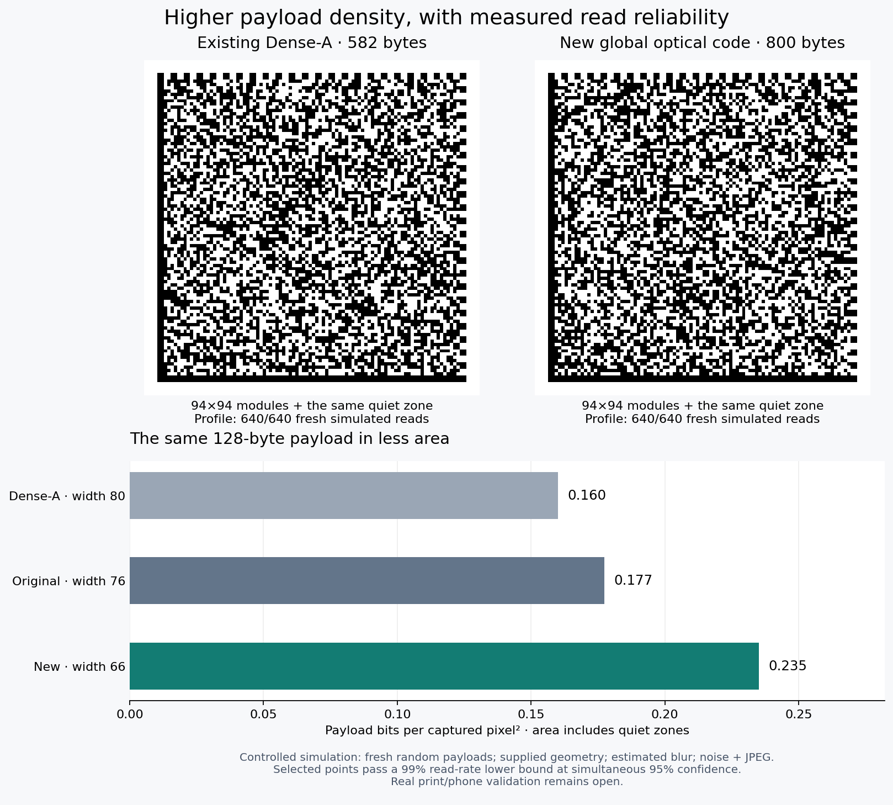

# A different barcode format with measured density gains

Research snapshot: 2026-10-19, based on main commit
`281db3aab62ac72255c676e03d866613bd0bfc7d`.

The working result is **PM257-TURBO-v0**, a new binary format and optical
receiver. It carries **800 arbitrary bytes in the same 94×94 grid** in which
the existing Dense-A format carries 582 bytes with the same eight-byte
integrity allowance: **37.46% more payload per area**. Both profiles decoded
640/640 fresh simulated captures. This is a density change, not a speed-only
optimization. The random-looking square appearance and frame remain familiar;
the codeword, protection layout, permitted rates, and reader change.

This result is limited to the specified registered simulation. No real printer
or phone has been validated in this experiment. There is no proof that the
complete format reaches maximum channel capacity, and no claim that joint
optical decoding or the underlying coding theory is newly invented.

For the next physical experiment, [PHOTO_PROTOCOL.md](PHOTO_PROTOCOL.md) describes
an offline screen target kit and paired distance captures. Generate it with
`python research/density/screen_targets.py --out /tmp/pascal-photo-kit`, then open
`START_PHOTO_TEST.html`. Analyze original files with
`python research/density/analyze_screen_photo.py --manifest /tmp/pascal-photo-kit/manifest.json photo.jpg`.
HEIC input additionally needs `pillow-heif`. The external markers provide
registration assistance and are accounted separately from barcode area.
For tightly cropped photos whose markers touch the image boundary, the
optional `--recover-cropped` flag identifies the target from consistent marker
IDs and locates its known timing frame in the original image. Enlarged padded
images are used only to identify markers. Payload decoding uses the original
captured resolution after rectification. Report this recovery separately from
the default marker-registration pipeline; it does not recover missing data bits.



## What changed

Dense v2 divides the data region into four spatial cosets, with separately
decoded IRA-LDPC codes at one common rate. The new format interleaves **one
global IRA-LDPC code across all data cells**. A receiver models how each module
contributes to the original sensor pixels after blur and pixel integration,
subtracts the known frame, and exchanges soft information with the code.
The code's tentative beliefs help untangle overlapping optical contributions;
the improved optical evidence is sent back to the code.

The separable native-pixel operator uses two one-dimensional SVDs, avoiding a
large dense two-dimensional inversion. The Gaussian interference model and
feedback are approximations. They work empirically here; they are not an
exact posterior algorithm or an ML decoder.

The outer GF(257) construction is retained. Every payload carries an eight-byte
BLAKE2s integrity tag. Baselines receive the same tag, use explicit byte mode,
and count every quiet-zone module in their area. The data are independently
generated incompressible bytes on every trial. There is no compression,
dictionary, URL indirection, or external payload store behind the result.

The same-grid high-rate result mainly shows that less redundancy can suffice
with this receiver in the tested channel. It does not isolate the contribution
of a global code from that of a higher code rate. A separate compact-symbol
experiment and feedback ablation give evidence about the receiver itself.

## Held-out image-to-byte results

The main plan selected eleven configurations from pilot runs, froze their
source digest, then tested 640 new frames per configuration using seeds
900000–900639. A second plan, selected from a separate pilot and frozen before
testing, checked two capacity profiles with seeds 1000000–1000639. Every frame
uses a new payload and new image noise. Total: **8,320 validation captures**.

The final summary applies one Bonferroni budget across all thirteen points,
with exact two-sided Clopper–Pearson intervals: per-tail alpha = 0.05/26.
Thus the simultaneous confidence is at least 95% under independent trials
within each point. Correlation between paired configurations does not invalidate
the union bound. With 640/640 successes, the lower read-rate bound is
**99.0276%**. Our chosen operating-point criterion is a lower bound of at
least 99%, not merely a 99% observed success fraction.

| Payload | Format/profile | Exterior width, pixels | Exact reads | Simultaneous lower bound | Meets criterion |
|---:|---|---:|---:|---:|:---:|
| 128 B | New / 0.55 | 64 | 632/640 | 96.8843% | No |
| 128 B | New / 0.55 | 66 | 640/640 | 99.0276% | Yes |
| 128 B | New / 0.55 | 68 | 640/640 | 99.0276% | Yes |
| 128 B | Original / L | 76 | 640/640 | 99.0276% | Yes |
| 128 B | Original / L | 78 | 640/640 | 99.0276% | Yes |
| 128 B | Dense / A | 80 | 640/640 | 99.0276% | Yes |
| 128 B | Dense / A | 82 | 640/640 | 99.0276% | Yes |
| 512 B | New / 0.65 | 112 | 639/640 | 98.6787% | No |
| 512 B | New / 0.65 | 116 | 640/640 | 99.0276% | Yes |
| 512 B | Dense / A | 128 | 632/640 | 96.8843% | No |
| 512 B | Dense / A | 132 | 640/640 | 99.0276% | Yes |
| 800 B | New / 0.85 | 160 | 640/640 | 99.0276% | Yes |
| 582 B | Dense / A | 160 | 640/640 | 99.0276% | Yes |

The smallest **tested** qualifying points imply:

| Comparison | Density ratio | Increase |
|---|---:|---:|
| 128 B: new width 66 versus Original-L width 76 | (76/66)² = 1.3260 | 32.60% |
| 128 B: new width 66 versus Dense-A width 80 | (80/66)² = 1.4692 | 46.92% |
| 512 B: new width 116 versus Dense-A width 132 | (132/116)² = 1.2949 | 29.49% |
| Same 94×94 grid, width 160: 800 B versus 582 B | 800/582 = 1.3746 | 37.46% |

These are comparisons with the repository's existing readers and fixed
profiles, not with all possible encoders, optimized baseline implementations,
or commercial barcode systems. Untested intermediate widths may also work.
The sample does not establish a globally minimal footprint. In particular,
639/640 at width 112 is insufficient for the preselected confidence criterion,
so the 512-byte comparison uses width 116.

Dense-A's existing maximum is 590 bytes before the common extra tag, hence
582 bytes in this comparison. The new rate-0.85 encoder's nominal maximum at
side 94 is 830 bytes including the tag allowance. **830 bytes was not subjected
to the held-out reliability test; the validated result is 800 bytes.**

### Capture model and its limits

- Axis-aligned, square, registered symbols with supplied corners/module
  centers and known format profile. No blind location or rate identification.
- Fixed magnification, so exterior width squared measures captured area.
  This is not a claim in bits/mm² without a specified printer and camera.
- Independent subpixel translation; Gaussian optical blur sigma uniform over
  0.525–0.875 camera pixels; sensor noise sigma 6 gray levels; JPEG quality 75.
- Black/white values 25/225 with a linear intensity response. The new receiver
  estimates blur from the existing frame fitter instead of receiving the true
  blur. Geometry and reflectance endpoints remain supplied/known.
- The renderer uses the repository's eightfold supersampling. The receiver
  instead uses an analytic pixel-integration model, so they are not identical
  forward implementations. They still share a Gaussian channel assumption.
- No print dot gain, gamma variation, shadows, perspective, motion blur,
  scratches, occlusion, local warps, or real phone captures in this validation.

There were zero accepted incorrect payloads among the 8,320 validation frames.
This is not a false-read probability theorem for arbitrary images. The tag is
an unkeyed integrity check, not authentication; no universal 2^-64 false-accept
claim follows from its length alone.

### Mechanism ablation

An exploratory matched-seed test at 128 B / rate 0.55 / width 66 uses 64 fresh
captures outside the validation seed sets. One optical/LDPC pass succeeds
47/64; sixteen feedback rounds succeed 64/64 on the same images. Both results
are recorded in the evidence archive. At width 80 the one-pass
receiver already succeeds 64/64. This localizes the value of feedback to the
more difficult optical regime; it does not establish an optimal schedule or
apportion every gain between the code and detector.

## Mathematical results and other ideas tested

[PROOFS.md](PROOFS.md) states and proves five scoped results:

- **PB-15:** the exact maximum separation between two ordered block-average
  darkness classes, each retaining 2^b fine patterns, is determined by a
  binomial-tail quantile. A 3×3 binary tile can encode a complete byte while
  its coarse bit survives any one module flip. The seven fine bits need their
  own protection. `coarse_fine.py` implements the bijection.
- **PB-16:** under registered separable white-Gaussian optics, the two-SVD
  projection retains a sufficient statistic. It does not lose signal
  information or count interpolated samples as independent observations.
- **PB-17:** Fano's inequality and a trace-power Gaussian relaxation give a
  channel-dependent upper bound on reliable payload. This describes what
  would be needed to justify the word “maximum.” Its numerical implementation
  is a relaxation estimate, not a certified physical capacity bound.
- **PB-18:** a spectral shift and parity-polytope dual witness can prove
  unique minimum optical squared error over the entire binary IRA code.
  All decisive arithmetic is checked with integers, separately from the
  floating-point optimizer.
- **PB-19:** the payload mapping is injective, including the outer byte code,
  systematic IRA code, and physical scrambling. Capacity is for arbitrary
  byte strings, independent of correction performance.

The published ML example certifies a 128-byte candidate at exterior width 128
using an explicit q8 rational optical model. Its positive exact margin is
56449147758171136 / 1048576. The certificate does **not** apply to all packets:
attempts around the density limit remained uncertified. A certificate proves
the chosen model's best codeword, not that the model describes real optics.

Two other modulation directions were actually implemented:

1. Odd-weight 2×2 tiles put three bits into four binary cells, separating a
   coarse intensity bit from two position bits. Oracle-stage information
   probes look promising, but use supplied previous stage truth and are not
   packet-rate demonstrations. They are not the source of the reported gain.
2. Four- and eight-level gray modules use independently coded bitplanes and
   a soft optical detector. In the tested pilot settings they did not provide
   a consistent advantage over binary modules. More nominal states do not
   automatically supply more reliable information after noise and blur.

Joint 2D equalization, multilevel coding, and LP decoding certificates have
substantial prior art; see the primary references in [PROOFS.md](PROOFS.md).
The concrete contribution is this format/receiver integration, measured
operating points, the shell construction specialization, and an inspectable
integer optical witness. No global novelty claim is made.

## Reproduction

Use Python 3.11+ and the repository development dependencies. Examples assume
the repository root. Limit BLAS threads for these small matrix problems.

```bash
python -m pip install -e '.[dev]'
export OPENBLAS_NUM_THREADS=1 OMP_NUM_THREADS=1
python -m pytest -q
node web/test_node.js

# Encode arbitrary bytes and demonstrate one registered simulated read.
python research/density/example.py --bytes 800 --rate 0.85 --width 160
# Or: --input /absolute/path/payload.bin --out /tmp/my-example

# Verify the published rational optical witness without rerunning an LP.
python research/density/ml_certificate.py research/density/certificate_example.json.gz

# Unpack raw logs to inspect or resume the frozen experiments.
tar -xzf research/density/evidence.tar.gz -C research/density
python research/density/validate.py
python research/density/validate_capacity.py
python research/density/summarize.py

# Optional figure regeneration.
python -m pip install matplotlib
python research/density/make_figures.py
```

`validation_plan.json` and `capacity_validation_plan.json` were written before
their corresponding tests. Drivers verify their selected source digests,
checkpoint every frame, and show progress/elapsed time/ETA. Unpacking the
evidence archive first makes a rerun resume rather than repeat the same frames.
For a genuinely new validation, use a separate plan, output, and unused seed
range instead of appending changed settings to a frozen study.

`combined_validation.json` is the authoritative 13-point statistical summary;
the individual summaries retain their original family-specific intervals.
`evidence_manifest.json` records dependency versions, source hashes and hashes
of every archived raw log. Discovery includes supplied-blur/oracle runs and
estimated-blur runs; they are explicitly exploratory and excluded from the
confirmatory counts. The main frozen drivers hash their listed source files,
not the complete transitive Python environment; the manifest and base commit
document that additional provenance.

Validation performed for this snapshot: **377 Python tests pass; 89 JavaScript
checks pass**. New tests cover byte mapping, all 2,304 one-flip cases for the
coarse shell bit, actual image-to-byte binary/gray decoding, optical soft
messages against direct Gaussian elimination, and exact-certificate tampering.

## Engineering status

This is a Python research format. The existing browser/JavaScript format and
production encoder are unchanged. The new code needs a new configured reader;
its profile is not self-describing in the existing frame. Its permutation
generation is NumPy-based and has no frozen cross-language wire contract yet.
The best next engineering test is a held-out print/phone study with independent
registration and calibrated intensity/blur variation, followed by code design
against that measured channel. Claiming a physical maximum before that would
exceed the evidence. The working, reproducible density gain above is the result
available now.
