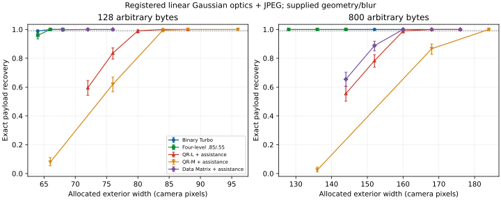
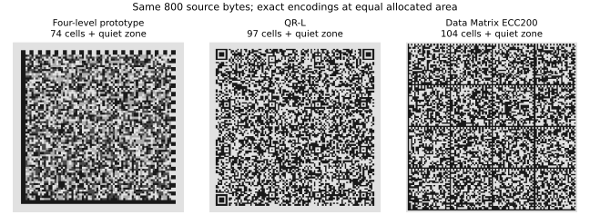

# PB-RELIABLE-01: four-level reliable-density research

The new four-level research profile recovered **800 arbitrary bytes in
1,024/1,024 fresh simulated captures at an allocated exterior width of 128
camera pixels**. The smallest tested qualifying widths were 160 for optimized
Data Matrix ECC200 and 168 for QR-L, using strengthened registered readers.
These operating points give **56.25% higher density than Data Matrix and
72.27% higher density than QR-L**, with native quiet zones included.

This is a substantial engineering result in one calibrated imaging model.
It establishes neither a mathematical capacity maximum nor world leadership.
The four-level format has not been validated with a real printer or phone.

## Smallest tested points meeting the reliability criterion

Qualification requires a simultaneous confidence lower bound of at least
99%, not just an observed success fraction of 99%.

| Source | Receiver/profile | Allocated width | Exact reads | Simultaneous lower bound |
|---|---|---:|---:|---:|
| 128 B | Binary Turbo .55 | 66 | 1024/1024 | 99.2495% |
| 128 B | Four-level .85/.55, a=.25 | 66 | 1024/1024 | 99.2495% |
| 128 B | Data Matrix ECC200 + assistance | 72 | 1024/1024 | 99.2495% |
| 128 B | QR-L + assistance | 84 | 1024/1024 | 99.2495% |
| 128 B | QR-M + assistance | 88 | 1024/1024 | 99.2495% |
| 800 B | Four-level .85/.55, a=.25 | 128 | 1024/1024 | 99.2495% |
| 800 B | Binary Turbo .85 | 144 | 1024/1024 | 99.2495% |
| 800 B | Data Matrix ECC200 + assistance | 160 | 1024/1024 | 99.2495% |
| 800 B | QR-L + assistance | 168 | 1024/1024 | 99.2495% |
| 800 B | QR-M + assistance | 184 | 1024/1024 | 99.2495% |
| 800 B | QR-Q + assistance | 216 | 1024/1024 | 99.2495% |
| 800 B | QR-H + assistance | 240 | 1024/1024 | 99.2495% |

The JSON records every point, including QR-Q/H and failed configurations.
At 128 B, QR-Q did not qualify at any tested width; QR-H qualified at width
100 with 1023/1024. These are finite sampled grids, not globally minimal
footprints. Untested intermediate widths or better receivers may reduce
the standards' required area.

For the 800-byte points, area is 128^2=16,384 versus 160^2=25,600 for Data
Matrix and 168^2=28,224 for QR-L. Thus **area reduction** is 36.00% and 41.95%,
respectively. Higher density and smaller area have different percentages.
Compared with the binary research receiver's width 144, the new point gives
26.5625% higher density. At 128 B, gray levels give no qualifying size
advantage over binary; the binary point already improves on the tested
Data Matrix and QR-L points by 19.01% and 61.98%.

## What changed

Each cell has four darkness values: 0, 1/4, 3/4 and 1. Two interleaved
LDPC-coded bit layers share the cell. Rate .85 protects the coarse layer;
the less separated fine layer receives stronger protection at rate .55.
A native-pixel optical model exchanges soft evidence with both layers.

Confidence-guided outer Reed-Solomon errors/erasures trials also use residual
information before all inner checks converge. On the 800 B / width 128 point,
21 packets were verified before every inner check was satisfied. This is an
early-recovery count, not proof that all 21 would fail an inner-only reader
after sixteen rounds. The initial paired binary image pilot found no extra
final reads from the outer change alone.

The selected 800-byte symbol has 74x74 cells, plus four quiet modules on
each side. The binary symbol has 94x94 cells plus the same quiet zone. QR-L
has 97x97 plus four quiet modules; Data Matrix has 104x104 plus one. These
different module counts do not imply equal camera reliability at equal
module pitch, which is why the study measures captured physical area.

The pattern figure shows exact encodings, not simulated photographs.
[RELIABLE_DECODING_NOTES.md](RELIABLE_DECODING_NOTES.md) gives the scoped
RS distance argument PB-21, mapping details, statistical accounting and
primary prior art. Multilevel barcodes and soft LDPC decoding predate this
work; this result is a tested integration and parameter choice.

## Matched comparison

Every trial uses new random source bytes. All formats carry the same useful
source length and eight-byte integrity allowance. Their native headers,
framing, ECC and quiet zones are counted. These uniformly random sources
use a common raw representation; no compression, Base64, external dictionary
or external payload store favors any format. The separate
[compression comparison](COMPRESSION_COMPARISON.md) remains available.

QR uses byte mode with error boosting disabled. All four protection levels
L/M/Q/H are tested. Data Matrix uses ECI 0 to suppress an optional binary
ECI identifier. Independent Segno and ZXing writers generate the standards.

All receivers receive exact geometry, actual blur and black/white endpoints.
The standards additionally get native ZXing, centre sampling, Gaussian LMMSE
deconvolution, bounded Chase lists and conditioning on their public finder
or region-border patterns. Pilot patterns come from independent layout rules;
no expected data grid is copied into a reader. Only after a decoder returns
is its result compared byte-for-byte with the source.

These baselines are stronger than native ZXing alone. They remain particular
implementations: commercial scanners and soft-input Reed-Solomon readers
have not been evaluated. The prototype also needs a supplied profile, whereas
the standards carry their format metadata.

## Frozen fresh-trial evidence

There are **51,200 newly rendered validation images**, **57,344 receiver
observations**, and 56 operating-point/receiver combinations. The binary
legacy and GMD results share an image and trajectory; they are not counted
as two independently rendered images. Discovery is excluded from these totals.

The original 48-point plan predates its trials. Eight follow-up standard
points, selected after discovery and early baseline readout, use a separate
fresh seed set. The combined report applies exact two-sided Clopper-Pearson
intervals with per-tail alpha=0.05/112 to all 56. A union bound, including
conditional coverage for the independently sampled follow-up points, gives
at least 95% simultaneous coverage. With 1024/1024 reads the lower bound is
99.2494876%; with one failure it is 99.0157912%. No optional stopping is used.

There are **zero accepted wrong source payloads** in the validation. This
empirical observation is not a universal false-read probability guarantee.

Sources are frozen at
[852586eb2031011f6f3666192b9fc721b0da536f](https://github.com/TACITVS/Pascal_2D_Barcode/commit/852586eb2031011f6f3666192b9fc721b0da536f).
Each job checks encoder/decoder/renderer files against that commit. Saved
per-group JSON includes source hashes, package versions, workflow/job IDs
and one outcome character for every trial. Full checkpoint diagnostics are
in the workflow artifacts; seeds and sources reproduce the rendered inputs.

* [Original validation run](https://github.com/TACITVS/Pascal_2D_Barcode/actions/runs/39474244371)
* [Independent baseline follow-up](https://github.com/TACITVS/Pascal_2D_Barcode/actions/runs/39474730772)
* [Combined results](reliable_combined_results.json)
* [Original plan](reliable_validation_plan.json)
* [Follow-up and combined budget](reliable_validation_annex.json)

## Imaging scope and next engineering target

The model is registered, axis-aligned, linear grayscale with endpoints
25/225, Gaussian blur sigma uniform over 0.525--0.875 camera pixels, white
sensor noise sigma 6 gray values, and JPEG quality 75. Every receiver is
given the actual blur. Allocated width squared measures captured area,
including native quiet zones. The raster also has two pixels of common
renderer padding; these are not symbol information.

No perspective estimation, unknown tone response, spatially varying light,
print dot gain, motion blur, local warp, occlusion or blind location is
validated here. The Gaussian receiver and supersampled renderer are separate
implementations but share the same Gaussian optics assumption.

The next substantial engineering problem is **self-calibration and blind
reading of the four-level code**. Intermediate gray values need tone
calibration; known black/white endpoints alone do not establish them on a
real screen/printer/phone chain. The current Python prototype has supplied
profile metadata and no frozen cross-language contract. Its speed and
compatibility are not established as superior to standard scanners.

The earlier binary photograph viewer and published physical test protocol
remain the binary reference. The new gray prototype needs a separately
calibrated, frozen photographic experiment before replacing that reference.

## Reproduce

From the repository root, using Python 3.12 and one BLAS thread:

    python -m pip install -e ".[dev,bench]" "numpy==2.5.4" "scipy==1.18.1" "opencv-python-headless==5.0.0.93" "segno==1.6.6" "zxing-cpp==3.1.1" matplotlib
    export OPENBLAS_NUM_THREADS=1 OMP_NUM_THREADS=1
    python -m pytest research/density/test_soft_outer.py research/density/test_reliable_density.py research/density/test_shaped_gray.py research/density/test_standard_assist.py research/density/test_validate_reliable.py
    python research/density/summarize_reliable.py

To repeat a frozen group (full Git history is required for the source check):

    python research/density/validate_reliable.py --plan research/density/reliable_validation_plan.json --group gray800 --out /tmp/confirm-gray800.json
    python research/density/validate_reliable.py --plan research/density/reliable_validation_annex.json --group annex-dm800 --out /tmp/confirm-annex-dm800.json

Drivers checkpoint each frame, refuse mismatched source/configuration on
resume, and print elapsed time and ETA. A genuinely new validation needs
unused seeds and a new plan; rerunning old seeds is reproduction, not new
evidence.
